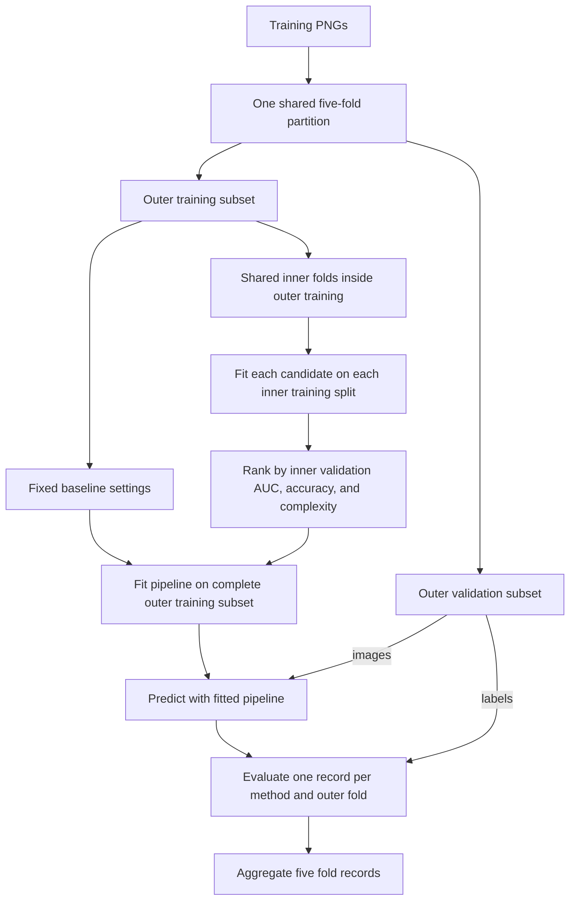

# Cross-validation experiments

The course handout requires a four-method, five-fold comparison and seven outputs per method. The combined lecture PDF covers the recognition and design cycle in Chapter 1 §§1.3–1.4 (PDF pp. 25–38) and learning curves and the roles of training, validation, and testing in Chapter 6 §6.3.3 (pp. 418–420). The nested search, subject grouping, benchmark repetitions, and ROC averaging are project decisions. See the [course requirements](project-requirements.md), [lecture reference](lecture-reference.md), and module guides for [PCA](pca-feature-extraction.md), [Fisher LDA](fisher-lda-feature-extraction.md), [Gaussian Bayes](gaussian-bayes-classifier.md), [MLP](mlp-classifier.md), and [ROC and benchmarking](evaluation-and-benchmarking.md).

## Pipeline interface

```matlab
setup;
config = defaultPipelineConfig;
pipeline = fitPipeline(imagesTrain, yTrain, "pca-bayes", config);
[yPred, scores] = predictPipeline(pipeline, imagesValidation);
```

The method identifiers are `pca-bayes`, `lda-bayes`, `pca-mlp`, and `lda-mlp`. The fit contains the preprocessing representation, projection, classifier, effective settings, dimensions, parameter counts, and training size. Each feature row represents one sample. Prediction preserves image order and uses the fitted states, including the MLP training mean and scale. Scores are female-class Gaussian log-posterior odds or MLP logits. Male is 0, female is 1, and a score of exactly zero predicts 0. ROC measures ranking performance. Probability calibration was outside the experiment.

## Data and separation

The default reads the repository's flat `train/` folder once. The official profile is 200 RGB 640 × 640 images with 100 male and 100 female labels. There are 50 class-qualified filename-derived subject IDs per class and two images per ID. These IDs support filename-level separation and cannot establish real-world identity uniqueness. The entry point reports a profile mismatch for the repository training folder, accepts an explicitly supplied training folder for other data, and refuses paths with a `test` component before loading. Supply only training images.

A single stratified subject-grouped outer partition (five folds, seed 42) serves all methods in both modes. Each official outer holdout has 40 images (20 per class) and 20 IDs (10 per class). Its complement has 160 images (80 per class) and 80 IDs (40 per class). Each inner split within that complement has 120 fit images and 40 validation images, with 60/20 per class and 60/20 total IDs respectively. Saved inner indices are relative to the outer fold's ordered training indices. Only training images and labels enter fitting and selection. Validation images enter frozen inference, and validation labels enter metric calculation after prediction.



## Fixed baseline and bounded nested search

| Component | Fixed baseline |
|---|---|
| Preprocessing | 64 × 64 grayscale, double, unit intensity, 4,096 inputs |
| PCA | 40 explicitly retained components. Lower numerical rank raises a fit error. |
| Fisher LDA | Relative regularization 0.01, one feature |
| Bayes | Full per-class covariance, empirical priors, relative regularization 0.01 |
| MLP | 16 tanh hidden units, learning rate 0.01, momentum 0.9, 300 epochs, batch size 16, L2 0.0001, training standardization, seed 42 |

Nested mode runs four inner folds with seed 42 and the same subject-grouping policy as the outer partition. Each outer fold uses one shared inner partition across candidates and methods. Starting with the baseline, the default search changes one applicable value at a time, in table order, and omits duplicate configurations. Preprocessing stays fixed within a search. Candidate counts are 7, 8, 11, and 12 in method order.

| Setting | Values in search order |
|---|---|
| PCA components | 10, 20, 40 |
| LDA regularization | 0.001, 0.01, 0.1, 1 |
| Bayes covariance | full, shared, diagonal |
| Bayes regularization | 0.001, 0.01, 0.1 |
| MLP hidden units | 8, 16, 32 |
| MLP learning rate | 0.005, 0.01, 0.02 |
| MLP epochs | 100, 300, 500 |
| MLP L2 | 0.0001, 0.001, 0.01 |

Every candidate fits each stage afresh in each inner split. Select candidates within absolute tolerance 1e−12 of the best mean inner AUC, then within the same tolerance of the best mean inner accuracy among those still eligible, then the fewest mean combined parameters, then the earliest candidate. Use the candidate's entire configuration for the outer refit. Failed fits retain all fold-level reasons and make the candidate ineligible. An outer method-fold with no feasible candidate makes the experiment incomplete. Search timings include fit, prediction, and inner evaluation, without benchmark repeats.

## Timing, parameters, and aggregation

`benchmarkOperation` performs two warm-ups and five measured repetitions per scope by default. The runner benchmarks serially in ascending fold order, cycling which method goes first. Complete in-memory fit and inference have their own direct measurements. Fit repetitions start fresh with the same inputs and seed. The first measured fit supplies the frozen model for all validation inference runs, using the full held-out batch. Separate timings cover preprocessing fit, train and validation preprocessing, projection fit, train and validation projections, and classifier-only fit and inference. Data loading, metrics, search, output, and figures are outside those ten scopes. Batch-derived seconds per image divide the batch median by the validation count. The report gives the mean and sample SD of the five medians. Timing samples depend on hardware and workload.

Classifier counts represent independent Gaussian parameters including the empirical prior, or trainable MLP weights and biases. The fitted projection and stored normalization coefficients are counted separately. The combined count adds these to the preprocessing count, which is zero for this representation.

For accuracy and AUC, compute the equal-weight mean of the five values and `std(values,0)` with denominator N−1. Retain all folds and their ranges, sum their confusion matrices with actual class on rows and prediction on columns, and divide total correct by total evaluated for sample-weighted accuracy. Dimension and parameter ranges summarize the actual fold configurations. Missing fold numbers, undefined AUC fold numbers, and the count of valid AUC folds are explicit. The complete-fold AUC summary remains undefined if any fold is missing or invalid. The fold SD describes variability among these folds. Shared training samples make it unsuitable as a confidence interval or evidence of statistical significance.

The mean ROC uses the union of FPR breakpoints. Each fold has a lower incoming and an upper outgoing TPR at a repeated FPR. Between consecutive breakpoints interpolate from the earlier outgoing TPR to the later incoming TPR. Average the incoming and outgoing values separately on the common grid, retaining vertical segments, the origin, and the terminal point. Trapezoidal integration is linear in the curves on this grid, so the plotted area agrees with the mean of valid fold areas up to rounding. Mean fold AUC is the primary statistic. A partial plot identifies how many curves contributed. Scores and thresholds stay local to their folds.

## Commands and local artifacts

Run from the repository root with base MATLAB R2026a Update 5 on Windows. Script execution uses the MATLAB Java runtime for path resolution and dataset hashing.

```powershell
matlab -wait -batch "run_tests;"
matlab -wait -batch "setup; run_cross_validation('train',struct('PlotFoldROC',true));"
matlab -wait -batch "setup; run_cross_validation('train',struct('Mode','nested','PlotFoldROC',true));"
```

`run_cross_validation()` uses the fixed baseline. `crossValidationConfig` lists the defaults. `TrainingPath` accepts a repository-relative or an absolute path, and a positional path takes precedence. `Pipeline` takes partial `Preprocessing`, `PCA`, `LDA`, `Bayes`, and `MLP` structs. `Partition` sets the outer seed and subject grouping. `Search` sets the inner seed and fold count and whether to generate full-training recommendations. Alternative candidates can be a cell vector of partial pipeline configs under each method key (`pca_bayes`, `lda_bayes`, `pca_mlp`, `lda_mlp`). For example, add a PCA dimension of 20 for PCA + Bayes with `config.Search.Candidates.pca_bayes = {struct('PCA',struct('NumComponents',20))};`. An empty cell vector evaluates just the configured baseline.

`ExportResults` and `GeneratePlots` default to true. `PlotFoldROC` enables the optional five-curve panels. Each run creates a unique subdirectory under `OutputDirectory/<mode>/` (default `results/cross-validation/`). Completed writes are published together from a temporary `.incomplete` directory. Run metadata explicitly marks runs with missing or undefined fold results as incomplete. Runs never replace one another.

| Local file | Contents |
|---|---|
| `experiment-config.json`, `experiment-metadata.json` | Settings and status, code revision and tracked-tree state, ordered decoded dataset SHA-256, environment and execution order |
| `folds.json` | Exact outer indices, sample-to-fold map, class and subject counts |
| `evaluation-results.json`, `evaluation-summary.csv` | Schema-v1 records, fold metric and timing summaries |
| `method-summary.csv`, `fold-details.csv` | Method summaries and fold ranges, detailed fold counts, timing and effective settings |
| `hyperparameter-search.json` | Nested candidate settings and results, failures, selected settings, inner assignments and costs, indexed by outer fold and recorded method order |
| `configuration-recommendations.json` | Baseline or training-only selected settings for the next issue |
| `predictions.mat` | Local aligned validation labels, predictions, and scores for reproduction checks |
| `figures/` | Mean ROC, optionally fold ROC, accuracy/AUC, and cost in PNG and vector PDF |

```matlab
setup;
baseline = loadCrossValidationRun(baselineRunDirectory);
nested = loadCrossValidationRun(nestedRunDirectory);
plotCrossValidationRun(baseline, fullfile(baseline.OutputDirectory, "regenerated"), true);
plotCrossValidationComparison(baseline, nested, fullfile("results", "cross-validation", "comparison"));
```

Reload reconstructs schema-v1 vectors, empty timings, the positive-infinity ROC threshold sentinel, and undefined AUC. It validates derived values against decoded primitives and rebuilds comparisons from the records without images or fitted models. Keep raw results under the ignored `results/` tree or another private location. Share only non-identifying aggregate metrics or suitable coordinate-only figures.

## Issue #12 handoff

The fixed settings are recorded for each method. The nested run can apply the identical candidate and tie-breaking rules to a seeded subject-grouped four-fold partition of all training data. This yields one configuration per method without fitting any final full-training models. Use the machine-readable recommendations to freeze settings before final training, or carry forward the fixed baseline. Choosing between procedures based on these outer results is exploratory and uses the same held-out evidence that estimates their performance.
