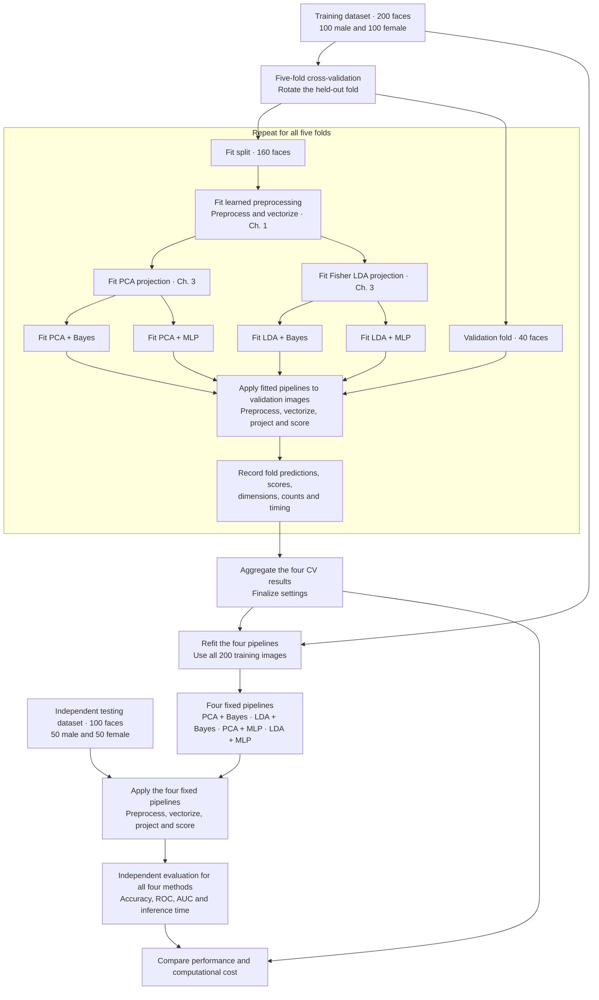

# Lecture Reference and System Architecture

[繁體中文](../zh-TW/lecture-reference.md) · [Project requirements](project-requirements.md) · [Project home](../../README.md)

## A. Mapping Between Project Requirements and Lecture Materials

The reference is the 480-page combined lecture deck `all.pdf`. **PDF page** is the 1-based position in that file. **Original slide page** is the number printed on the source slide, which can restart by chapter. Chapter 6 opens on an unnumbered title slide at PDF page 379, and its printed page 1 is PDF page 380.

Coverage describes what the slides teach. “Fully covered” means the slides explain the method or concept needed for the project. The implementation notes describe how to apply that material to the project. See the [official requirements](project-requirements.md) for grading, deliverables, and deadlines.

| Project Requirement | Lecture Chapter / Section | PDF Page Numbers | Original Slide Page Numbers | Coverage | Implementation Notes |
|---|---|---|---|---|---|
| Training, validation, and independent testing | Ch. 1 §§1.4.4–1.4.5; Ch. 6 §6.3.3 | 37–38; 418–420 | Ch. 1: 37–38; Ch. 6: 39–41 | Partially covered | The slides discuss training, generalization, and the separate roles of validation and test sets. Implement configurable data paths, fold-wise fitting, and final testing on the reserved images. |
| Image preprocessing and feature vector | Ch. 1 §1.2 (classifier design example), §1.3 | 12, 25–29 | 12, 25–29 | Partially covered | The slides introduce feature space, sensing, segmentation, feature extraction, and classification. Define a consistent image representation and vector ordering, and estimate any learned preprocessing using training samples. |
| Principal component analysis (PCA) | Ch. 3 §3.8.1 | 277–290 | 89–102 | Fully covered | The slides derive the mean-centered minimum-reconstruction-error projection onto the leading scatter eigenvectors. Choose the retained dimension using training data and reuse the fitted mean and projection at evaluation. |
| Linear discriminant analysis (LDA) | Ch. 3 §3.8.2 | 291–312 | 103–124 | Fully covered | The slides derive the two-class Fisher projection from between-class and within-class scatter and give a worked example. Fit the projection from labeled training data and handle singular within-class scatter when necessary. |
| Multiple discriminant analysis (MDA) | Ch. 3 §3.8.3 | 313–316 | 125–128 | Fully covered | The slides explain the multiclass projection through the between-class and within-class scatter matrices and a determinant criterion. This generalization gives context for Fisher LDA, which has one discriminant direction for the project's two classes. |
| Bayes classifier | Ch. 2 §§2.2–2.6 | 74–84, 86–115, 117–126, 128–141, 143–179 | 25–35, 37–66, 68–77, 79–92, 94–130 | Fully covered | The slides cover priors, posteriors, decision risks, discriminant functions, and Gaussian covariance cases. Choose a likelihood model, fit its parameters from training features, and return both labels and continuous scores. |
| Gaussian distribution | Ch. 2 §2.5 | 128–141 | 79–92 | Fully covered | The slides explain univariate and multivariate Gaussian densities, covariance, whitening, and the geometry of equal-density contours. Choose a covariance structure and compute log densities stably in the projected feature space. |
| Maximum-likelihood parameter estimation | Ch. 3 §§3.2.1–3.2.4 | 195–221 | 7–33 | Fully covered | The slides derive maximum likelihood and log-likelihood, estimate Gaussian means and covariances, and discuss estimator bias. Use training-fold features and document the covariance normalization convention. PDF pages 220–221 finish the bias derivation. |
| Multilayer perceptron (MLP) | Ch. 6 §§6.2–6.3 | 386–394, 396–420 | 7–15, 17–41 | Fully covered | The slides cover layers, weights, biases, activations, supervised learning, and training protocols. Choose and document the network architecture and training settings and retain a continuous output for ROC analysis. |
| Feedforward operation | Ch. 6 §§6.2–6.2.1 | 386–394 | 7–15 | Fully covered | The slides show weighted inputs, bias, activations, and how outputs serve as class discriminants. Apply the fitted network to PCA or LDA features and define the positive-class score. |
| Backpropagation | Ch. 6 §§6.3–6.3.3 | 396–420 | 17–41 | Fully covered | The slides derive gradient-based updates and give stochastic and batch algorithms. Set initialization and stopping using the training portion, reserve the held-out fold for validation, and keep the independent test set for final evaluation. |
| Four PCA/LDA and Bayes/MLP pipelines | Ch. 1 §§1.3–1.4; method sections above | 25–38 | 25–38 | Partially covered | The slides describe the recognition pipeline and design cycle. Combine the verified methods into all four pipelines, using the same folds and evaluation protocol. |
| ROC curve | Ch. 2 §2.8.3 | 181–186 | 132–137 | Fully covered | The slides define the hit rate and false-alarm rate and illustrate how sweeping the threshold traces the ROC curve. Use observed TPR and FPR from continuous scores and known labels. |
| Area under the ROC curve (AUC) | Ch. 2 §2.8.3 (related ROC material) | 181–186 | 132–137 | Related theoretical concepts only | The ROC axes and threshold sweep are explicit. The slides give no AUC definition or calculation procedure. Compute the area of the empirical curve with a documented scoring and ties convention. |
| Classification accuracy | Ch. 2 §2.3 (minimum error and zero–one loss) | 86–90 | 37–41 | Partially covered | The slides explain correct and incorrect decisions under zero–one loss and minimizing expected error. For the project, compute correct predictions divided by evaluated samples and state how fold-level results are aggregated. |
| Five-fold cross-validation | Ch. 1 §1.4.5; Ch. 6 §6.3.3 (related evaluation material) | 38; 418–420 | Ch. 1: 38; Ch. 6: 39–41 | Related theoretical concepts only | The slides discuss overfitting and the roles of validation and test sets. They give no procedure for forming five folds, rotating the held-out fold, or aggregating results. Implement those steps using only the training dataset. |
| Feature-vector dimensionality analysis | Ch. 3 §§3.7–3.8 | 258–274, 276–316 | 70–86, 88–128 | Partially covered | The slides connect dimension, sample size, accuracy, and computational complexity and derive linear projections. Record input and retained dimensions and compare their effects experimentally. |
| Model parameter count | Ch. 3 §§3.2.3, 3.7.2; Ch. 6 §§6.2–6.3.1 | Ch. 3: 211–216, 268–272; Ch. 6: 386–394, 396–398 | Ch. 3: 23–28, 80–84; Ch. 6: 7–15, 17–19 | Partially covered | The slides enumerate distinct covariance entries and describe Gaussian means, priors, MLP weights, and biases. Define a common scope for the parameter count and account for shared, fixed, and redundant parameters consistently. |
| Training time analysis | Ch. 3 §3.7.2 | 266–272 | 78–84 | Related theoretical concepts only | The slides analyze operation counts for Gaussian parameter estimation, including the role of feature dimension and sample size. Measure elapsed fit time for preprocessing, projection, and classifier training with a consistent timing boundary. |
| Inference time analysis | Ch. 3 §3.7.2 | 266–267, 273 | 78–79, 85 | Related theoretical concepts only | The slides analyze operation counts for classifying a test vector with Gaussian discriminants. Benchmark the evaluation path at a consistent batch size and specify what operations the timer includes. |
| MATLAB implementation | No MATLAB-specific instruction identified in the combined deck | — | — | Not covered | MATLAB is required by the project handout. Select MATLAB functions or write code for loading, fitting, scoring, plotting, and timing, then document the settings and workflow. |

## B. Final Project System Architecture

- **Fit and apply.** Each fold learns any preprocessing parameters, the PCA mean and projection, the supervised LDA projection, and each classifier from its 160-image fit split. Evaluate the frozen pipeline on the 40-image holdout. These counts assume equally sized folds. Each image is held out once across the five folds.
- **Lecture connections.** Chapter 1 covers feature vectors and recognition systems. Chapter 2 covers Bayes classification and ROC. Chapter 3 covers PCA, Fisher LDA, and parameter estimation. Chapter 6 covers MLP feedforward inference and backpropagation.
- **Cross-validation outputs.** For every pipeline, report accuracy, ROC, AUC, feature-vector dimensionality, model parameter count, training time, and inference time. Use the same folds for comparisons. If tuning hyperparameters, use training data only and document the selection process. An assessment of a tuning procedure can use an inner split within each training portion to keep the corresponding held-out fold reserved for evaluation.
- **Independent test outputs.** Fix all four final pipelines before using the 100 test images. The test data are reserved exclusively for final evaluation, where each method reports accuracy, ROC, AUC, and inference time. Feature dimensions, parameter counts, and training times come from the training-side analysis.

## C. Implementation Considerations

Use the [project requirements](project-requirements.md) for mandatory items such as MATLAB. The following practices are implementation choices.

- **High-dimensional image vectors.** Flattening images can yield many more features than training samples. Keep pixel ordering consistent. Grayscale conversion, resizing, and intensity normalization are options to document and apply consistently.
- **Singular covariance.** A centered sample covariance from $n$ samples has rank at most $n-1$. In high dimensions or with redundant features, a Gaussian covariance or within-class scatter matrix may be singular. Consider an appropriate covariance structure or regularization. Use a stable factorization or linear solve where applicable.
- **Economy SVD for PCA.** With samples in rows, center the training matrix and use leading right singular vectors as the projection directions. Economy SVD avoids forming a full feature-by-feature scatter matrix. Retain components within the numerical rank and reuse the training mean for held-out data.
- **Regularized Fisher LDA.** For two classes, one option is to solve $(S_W + \lambda I)w = \mu_1-\mu_2$, where $S_W$ is within-class scatter and $\lambda > 0$. Fit class means and scatter on the training split and choose regularization with training data. The scalar projection is $w^\top x$.
- **Data leakage and subject grouping.** Split before fitting any transforms. If reliable subject IDs are available and a person has multiple images, consider grouping all their images in a single cross-validation fold. Preserve class balance as closely as practical and document any resulting departures from the illustrative fold sizes.
- **Continuous scores for ROC and AUC.** Choose the same positive class throughout. For Bayes, use a posterior or log-discriminant difference. For MLP, use a positive-class output score. Sweep thresholds on held-out scores to obtain ROC points and compute their area, for example by trapezoidal integration with tied scores handled together.
- **Consistent parameter counts.** For a Gaussian Bayes model with $d$ features and $C$ classes, a full class-specific covariance has $d(d+1)/2$ distinct entries per class, and each class has $d$ mean entries. Count a shared covariance once and include $C-1$ independent prior parameters if the priors are fitted. A fully connected MLP with layer widths $n_0,\ldots,n_L$ has $\sum_{\ell=1}^{L}(n_{\ell-1}+1)n_\ell$ weights and biases. Report classifier counts consistently, with separate figures if also reporting learned preprocessing and projection parameters.
- **Consistent timing.** Define what training and inference include, such as preprocessing, projection, scoring, and disk I/O. Use consistent hardware and batch sizes, repeat measurements, and report units and the aggregation method. Report whether inference timing is per image or per batch.
