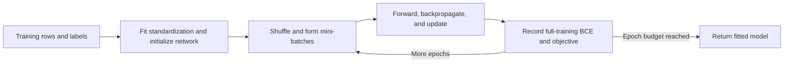

# Multilayer perceptron classifier

[繁體中文](../zh-TW/mlp-classifier.md) · [Project home](../../README.md) · [Lecture reference](lecture-reference.md)

## Architecture and scores

A multilayer perceptron (MLP) learns nonlinear decision boundaries from projected features and binary labels. Its input width is inferred from the training matrix. The default architecture is K → 16 → 1, and `HiddenLayerSizes = [32 16]` gives K → 32 → 16 → 1. Each layer has trainable weights and biases.


For a batch of B rows, let $A_0$ be the B × K input after any standardization. For layer $l$, $W_l$ has shape $n_{l-1}\times n_l$ and $b_l$ is a $1\times n_l$ row broadcast across samples. The forward pass computes $H_l=A_{l-1}W_l+b_l$ and $A_l=\tanh(H_l)$ at each hidden layer. The output is $t=H_L$, a single logit per row. The implied probability for female (1) is $p=\sigma(t)=1/(1+e^{-t})$. Empirical probability calibration has not been measured.

`predictMLP` returns the logit as the continuous score. Larger scores indicate stronger evidence for female (1), and scores at or below zero predict male (0). The logit preserves ordering even when sigmoid outputs round to 0 or 1. Each row is scored independently with the fitted coefficients.

## Objective and backpropagation

For a binary label $y$, the probability-domain binary cross-entropy (BCE) is $-y\log(p)-(1-y)\log(1-p)$. The implementation evaluates its stable equivalent in the logit domain. For the signed margin $m=(1-2y)t$, each sample contributes $\max(m,0)+\log(1+e^{-|m|})$, with `log1p` preserving small losses. Exponential inputs are nonpositive, including for logits around ±1000.

The regularized objective is $J=\operatorname{mean}(\mathrm{BCE})+\frac{\lambda}{2}\sum_l\|W_l\|_F^2$. The regularizer applies to weights in every layer, including the output, and has the same coefficient in a short final batch. Biases are unregularized.

Differentiating softplus with respect to the logit gives $\sigma(t)-y$. The code computes the equivalent signed wrong-class probability, $(1-2y)\sigma(m)$, to preserve small derivatives for confidently correct predictions. It uses $r=e^{-|m|}$ and computes $\sigma(m)$ as $r/(1+r)$ for $m\le0$ and $1/(1+r)$ for $m>0$. Dividing by B once at the output accounts for the mean BCE. The chain rule then gives

$$
D_L=(\sigma(t)-y)/B,\qquad
D_{l-1}=(D_l W_l^{\mathsf T})\odot(1-A_{l-1}^2) \quad (l>1).
$$

The weight gradient is $A_{l-1}^{\mathsf T}D_l+\lambda W_l$ and the bias gradient is the column sum of $D_l$. The code checks gradient shapes and finite values, then updates all layers using gradients computed at the original forward-pass weights. Forward values, the objective, standardized features and parameter updates are also checked for finite values. Arithmetic beyond the supported double-precision range raises `genderRecognition:MLPNumericalRange`.

## Training, initialization, and standardization



1. Fit feature means and sample standard deviations on the supplied training rows only. MATLAB's `std(ZTrain,0,1)` uses denominator N−1. A constant feature uses its observed value as the exact mean and scale 1. If a varying column's `std` is zero or nonfinite, the code recomputes it with scaled residuals to avoid squaring extreme values directly. Valid positive scales are preserved. With `Standardize = false`, both fitted normalization arrays are empty.
2. Initialize every weight matrix, including the output, uniformly within ±√(6/(fan-in + fan-out)) using Glorot/Xavier initialization. Initialize the biases and momentum buffers to zero.
3. Reuse the same local seeded `mt19937ar` stream for initialization and one `randperm` per epoch. Walk the shuffled rows in consecutive batches, including the final short batch. If the requested batch is larger than the training set, use one full batch. The global MATLAB RNG state is unchanged.
4. Update each weight and bias with $v\gets\beta v-\eta\nabla J$ and $\theta\gets\theta+v$. Set `Momentum = 0` for ordinary gradient descent and `L2Regularization = 0` to disable the penalty.
5. Evaluate full-training BCE and objective at initialization (epoch 0) and after every epoch. The fit stops at `MaxEpochs`. Both histories have `MaxEpochs + 1` entries and may fluctuate. Training, standardization, and the stopping rule use only the supplied training rows.

Repeated fits use the same initialization and batch order for the same data, configuration, and seed. Exact fitted state and scores were reproduced on the verified host. Results may vary across MATLAB versions, hardware, and numerical libraries. The single supported hidden activation is `tanh`. The defaults are engineering baselines, and fitting uses a fixed epoch budget. Early stopping, hyperparameter selection, and formal comparison are deferred.

## Interface and fitted model

```matlab
mlpModel = fitMLP(ZTrain, yTrain, config);
[yPred, scores] = predictMLP(mlpModel, ZValidation);
```

Features are full, real, finite N × K single or double matrices, one sample per row, with K ≥ 1. Calculations use double precision. Training labels are an aligned N × 1 double column of 0 and 1 with both classes present. Both prediction outputs are N × 1 double columns in input order. A correctly shaped `zeros(0,K)` yields two 0 × 1 columns. Prediction reuses fitted standardization and leaves the model and RNG unchanged. Invalid inputs, options, and inference fields raise `genderRecognition:InvalidMLPFeatures`, `InvalidMLPLabels`, `MissingMLPClass`, `InvalidMLPConfig`, or `InvalidMLPModel` under the same namespace.

```matlab
config = struct('HiddenLayerSizes', 16, 'Activation', "tanh", ...
    'LearningRate', 0.01, 'Momentum', 0.9, 'MaxEpochs', 300, 'BatchSize', 16, ...
    'L2Regularization', 1e-4, 'Standardize', true, 'RandomSeed', 42);
```

Omit the config or supply a scalar struct with selected overrides. Hidden widths, epochs, and batch size are positive integers. The learning rate is finite and positive, momentum is in [0, 1), and L2 strength is finite and nonnegative. The seed is an integer from 0 through 2³²−1, and `Standardize` is logical.

| Fields | Contents |
|---|---|
| `ClassLabels`, `ClassCounts`, `NumTrainingSamples` | Class order [0 1] and training counts |
| `NumFeatures`, `LayerSizes`, `Weights`, `Biases`, `Activation` | Network dimensions, one weight matrix and bias row per layer, and hidden activation |
| `StandardizationMean`, `StandardizationScale`, `NumNormalizationParameters` | Training-only normalization and its stored coefficient count |
| `NumClassifierParameters` | Number of elements in all weight and bias arrays |
| `EpochsCompleted`, `StoppingReason` | Completed epochs and `"MaxEpochs"` |
| `InitialTrainingLoss`, `FinalTrainingLoss`, `InitialTrainingObjective`, `FinalTrainingObjective` | Full-training BCE and regularized objective endpoints |
| `TrainingLossHistory`, `TrainingObjectiveHistory`, `Options` | Full-training histories and effective settings, including `Initialization = "glorotUniform"` and `RandomStream = "mt19937ar"` |

The stored coefficient count is checked against $\sum_{l=1}^L (n_{l-1}+1)n_l$. The model stores no training rows, training predictions, activations, or optimizer buffers. Normalization uses 2K stored coefficients when enabled, zero otherwise.

| Input width | K → 16 → 1 | K → 32 → 16 → 1 | Normalization enabled |
|---|---:|---:|---:|
| 1 | 49 | 609 | 2 |
| 40 | 673 | 1,857 | 80 |

Issue #10 can consume positive-class logits, `NumFeatures`, `NumClassifierParameters`, `NumNormalizationParameters`, and the projection's `NumFittedParameters`. Report the three parameter counts separately and time classifier fit and batch prediction in seconds with I/O, preprocessing, and projection outside those timers. Issue #11 should share the same outer fold indices across pipelines, refit each learned stage inside each training fold, and use training-only data for any configuration selection.

## PCA and LDA usage

```matlab
setup;
[images, y, subjects] = loadDataset("train");
folds = createFolds(y, subjects);
tr = folds(1).TrainIndices;
va = folds(1).ValidationIndices;
prep = fitPreprocessor(images(tr));
XTrain = transformImages(prep, images(tr));
XValidation = transformImages(prep, images(va));

pcaModel = fitPCA(XTrain, struct('NumComponents', 40));
pcaMLP = fitMLP(transformPCA(pcaModel, XTrain), y(tr));
[yPCA, scorePCA] = predictMLP(pcaMLP, transformPCA(pcaModel, XValidation));

ldaModel = fitLDA(XTrain, y(tr));
ldaMLP = fitMLP(transformLDA(ldaModel, XTrain), y(tr));
[yLDA, scoreLDA] = predictMLP(ldaMLP, transformLDA(ldaModel, XValidation));
```

For aggregate diagnostics, run `run_mlp_analysis` for PCA or `run_mlp_analysis("train","lda")` for LDA. Positional options are training path, method, MLP config, PCA or LDA config, preprocessing config, fold number, and a logical flag to plot the two training curves (default false). For a wider network, run `run_mlp_analysis("train","pca",struct('HiddenLayerSizes',[32 16]))`. The function returns aggregates and writes no files.

## Verified numerical results

Official subject-grouped fold 1 used 160 training images (80 per class), 40 held-out training-set images (20 per class), and zero subject-ID overlap. The training dataset had 200 RGB images at 640 × 640 × 3. Default 64 × 64 grayscale preprocessing produced a 200 × 4,096 double matrix with intensity range [0.00157612745, 0.99418915].

| Fold 1 diagnostic | PCA + MLP | LDA + MLP |
|---|---:|---:|
| Projected training / validation shapes | 160 × 40 / 40 × 40 | 160 × 1 / 40 × 1 |
| Architecture | 40 → 16 → 1 | 1 → 16 → 1 |
| Trainable / normalization / projection counts | 673 / 80 / 167,936 | 49 / 2 / 8,192 |
| Completed epochs | 300 | 300 |
| Initial → final training BCE | 0.868467145 → 0.000761819203 | 0.388212996 → 0.000505941768 |
| Initial → final training objective | 0.869757184 → 0.00288934358 | 0.388392720 → 0.00147054127 |
| Label / score shapes | 40 × 1 / 40 × 1 | 40 × 1 / 40 × 1 |
| Finite scores / distinct scores | 40/40 / 40 | 40/40 / 40 |
| Score range | [−9.95149305, 10.1933641] | [−9.11846970, 10.3216234] |
| Predicted counts [male, female] | [20, 20] | [20, 20] |
| Classifier fit / 40-row prediction (s) | 0.453999 / 0.006368 | 0.229166 / 0.002474 |

Timings are single local measurements that include call overhead. Repeating both fits produced identical models and scores. In-memory changes to the held-out images changed scores and left fitted preprocessing, projection, standardization, and network state identical. The representative fold verifies numerical behavior only. The independent test dataset was untouched.

## Tests and lecture references

```powershell
matlab -wait -batch "run_tests;"
matlab -wait -batch "setup; run_mlp_analysis; run_mlp_analysis('train','lda');"
```

Windows, MATLAB R2026a Update 5 (26.1.0.3346908). Only base MATLAB is required. The first command ran all 115 tests (96 existing and 19 MLP), with zero failures or incomplete tests. It uses synthetic numeric data and temporary PNGs. The second command requires the local official training dataset.

Gradient checking perturbs each weight and bias by ±$10^{-5}$ in a two-hidden-layer network with nonzero L2. It compares central differences of the production objective with analytical backpropagation. The largest scale-aware relative error was $1.38\times10^{-10}$ using denominator $\max(10^{-6},|g_{\mathrm{num}}|+|g_{\mathrm{analytic}}|)$. Both linear fixtures classified all 6 training rows and 2 probes correctly. XOR classified all 4 training rows and 4 probes correctly, with training BCE decreasing from 0.728666155 to 0.00761152654.

Local lecture materials confirmed Chapter 6 §§6.2–6.3. Combined PDF pages 386–394 cover affine input, nonlinear feedforward operations, and XOR. Pages 396–420 cover chain-rule learning, update schedules, and learning curves. Additional references are §§6.8.3, 6.8.8, 6.8.10, and 6.8.16 for scaling (pp. 435–436), initialization (445–447), momentum (448–452), and cross-entropy (471–480). The project chooses the one-logit BCE formulation, stable arithmetic, Glorot bound, seeded mini-batches, velocity convention, training-only normalization, and fixed-epoch defaults. [Lecture mapping](lecture-reference.md)
