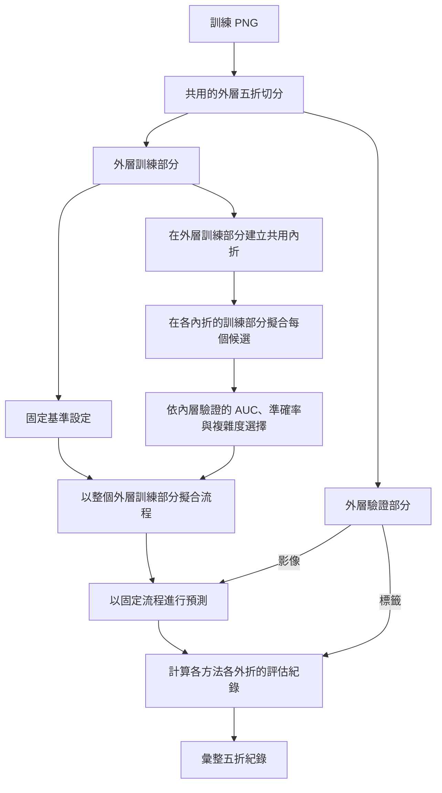

# 交叉驗證實驗

課程專題說明要求比較四種方法的五折交叉驗證結果，並產出七項評估結果。合併講義第 1 章 §§1.3–1.4（PDF 第 25–38 頁）介紹辨識流程與設計循環，第 6 章 §6.3.3（第 418–420 頁）討論學習曲線與訓練、驗證及測試的用途。巢狀搜尋、依受試者分組、重複量測與 ROC 彙整是本專題的實驗設計。請參閱[專題說明](project-requirements.md)、[講義對照](lecture-reference.md)，以及 [PCA](pca-feature-extraction.md)、[Fisher LDA](fisher-lda-feature-extraction.md)、[高斯貝氏](gaussian-bayes-classifier.md)、[MLP](mlp-classifier.md) 和 [ROC 與效能量測](evaluation-and-benchmarking.md)的模組文件。

## 分類流程介面

```matlab
setup;
config = defaultPipelineConfig;
pipeline = fitPipeline(imagesTrain, yTrain, "pca-bayes", config);
[yPred, scores] = predictPipeline(pipeline, imagesValidation);
```

四種方法的識別字串為 `pca-bayes`、`lda-bayes`、`pca-mlp` 和 `lda-mlp`。擬合後的流程包含前處理表示、特徵投影、分類器、實際設定、特徵維度、參數量與訓練樣本數。特徵矩陣的一列代表一筆樣本。預測保留影像輸入順序，並沿用各階段已擬合的狀態，包括 MLP 的訓練平均值與尺度。分數為女性類別的高斯對數後驗勝算或 MLP logit。男性標籤為 0，女性為 1，分數恰為零時預測為 0。ROC 評估排序表現，本實驗未測量機率校準。

## 資料與切分

預設讀取一次儲存庫中的平面 `train/` 目錄。正式訓練資料預期有 200 張 640 × 640 的 RGB 影像，男女各 100 張。每類有 50 個帶類別前綴、由檔名解析出的受試者 ID，每個 ID 有兩張影像。這些 ID 提供檔名層級的分離，無法獨立確認現實中的身分是否重複。若儲存庫的訓練資料不符預期，入口會發出警告。也可指定其他訓練目錄。入口會在載入前拒絕包含 `test` 路徑元件的目錄。

兩種模式的四種方法皆使用同一組依類別分層、依受試者分組的外層五折切分（種子 42）。正式資料每個外層保留折有 40 張影像（每類 20 張）及 20 個 ID（每類 10 個）。其餘 160 張（每類 80 張）及 80 個 ID（每類 40 個）用於擬合。每個內層分割的訓練與驗證部分分別涵蓋 120、40 張影像，每類分別為 60、20 張，ID 總數分別為 60 和 20。儲存的內層索引對應至該外層訓練部分的排序索引。擬合與設定選擇只接收當折訓練資料。驗證影像輸入固定流程進行預測，驗證標籤在預測後才用來計算指標。



## 固定基準與巢狀搜尋

| 元件 | 固定基準 |
|---|---|
| 前處理 | 64 × 64 灰階、double、單位強度尺度，共 4,096 個輸入特徵 |
| PCA | 明確保留 40 個成分，數值秩不足時回報擬合錯誤 |
| Fisher LDA | 相對正則化 0.01，輸出一維特徵 |
| 貝氏 | 各類別完整共變異數、經驗先驗機率、相對正則化 0.01 |
| MLP | 16 個 tanh 隱藏單元、學習率 0.01、動量 0.9、300 個訓練週期、批次大小 16、L2 係數 0.0001、以訓練資料標準化、種子 42 |

巢狀模式在每個外層訓練部分建立一次內層四折（種子 42），沿用相同分組原則，共用於所有候選和方法。搜尋先評估固定基準，再依表中順序逐一變更單項適用設定並省略重複設定。前處理設定在同一搜尋中固定。依四種方法的順序，候選數為 7、8、11、12。

| 設定 | 搜尋值順序 |
|---|---|
| PCA 成分數 | 10、20、40 |
| LDA 正則化 | 0.001、0.01、0.1、1 |
| 貝氏共變異數結構 | full、shared、diagonal |
| 貝氏正則化 | 0.001、0.01、0.1 |
| MLP 隱藏單元 | 8、16、32 |
| MLP 學習率 | 0.005、0.01、0.02 |
| MLP 訓練週期 | 100、300、500 |
| MLP L2 | 0.0001、0.001、0.01 |

各候選在每個內折獨立擬合全部階段。先保留與最佳平均內折 AUC 相差至多 1e−12 的候選，再於其中保留與最佳平均內折準確率相差至多 1e−12 的設定，接著選平均合計參數量最少者，仍相同時採最早列出的候選。以勝出的完整設定進行外層擬合。保留各內折的擬合失敗原因，有失敗的候選不參與選擇。若任一方法在某外折沒有可行候選，實驗標記為未完成。搜尋時間包含內折擬合、預測與評估，每次只執行一次。

## 計時、參數量與跨折彙整

`benchmarkOperation` 預設每個項目暖機兩次並量測五次。各折順序執行，先執行的方法依折輪換。直接量測記憶體內的完整擬合與推論，另量測前處理擬合、訓練及驗證影像前處理、投影擬合、訓練及驗證特徵投影、分類器擬合與推論。每次擬合皆以相同輸入與種子重新開始。第一次正式量測所得模型用於整批驗證與各次推論量測。讀取、評估指標計算、搜尋、輸出及繪圖均在這十項量測範圍之外。批次中位秒數除以驗證樣本數可換算每張影像的耗時。報告列出五個折中位數的平均及樣本標準差。時間會隨硬體及執行負載而異。

分類器參數量計算高斯模型的獨立統計參數（含經驗先驗機率）或 MLP 可訓練的權重及偏差。投影及儲存的標準化係數分別計數。合計參數量另加上前處理參數，此處的前處理參數量為零。

準確率及 AUC 採五個折值的等權平均，以及分母為 N−1 的樣本標準差 `std(values,0)`。保留各折數值及最小／最大值，加總混淆矩陣（列為實際類別，欄為預測類別），另以正確預測總數除以樣本總數得到加權準確率。特徵維度與參數量範圍採各折實際值。缺失折、AUC 未定義的折及有效 AUC 折數均明確標記。任一折缺失或無效時，完整五折的 AUC 指標維持未定義。標準差描述這五折的變化。各折訓練樣本重疊，不能視為信賴區間或統計顯著性的證據。

平均 ROC 採各折 FPR 轉折點的聯集。每個重複 FPR 的垂直線段分別保留最低的進入 TPR 及最高的離開 TPR。相鄰 FPR 之間，從左端離開 TPR 線性插值到右端進入 TPR。對同一位置的進入值及離開值分別平均，以保留垂直線段、原點和終點。共同網格上的梯形積分具有線性，因此彙整曲線的面積與有效各折 AUC 的平均一致，容許浮點捨入差異。主要統計量是平均逐折 AUC。僅有部分有效曲線時，圖例顯示有效折數。分數及閾值保留於各折的本機紀錄。

## 執行與本機產物

在儲存庫根目錄執行。本專題使用 Windows 上的 MATLAB R2026a Update 5 基礎環境。入口使用 MATLAB 的 Java 執行環境解析路徑及計算資料指紋。

```powershell
matlab -wait -batch "run_tests;"
matlab -wait -batch "setup; run_cross_validation('train',struct('PlotFoldROC',true));"
matlab -wait -batch "setup; run_cross_validation('train',struct('Mode','nested','PlotFoldROC',true));"
```

`run_cross_validation()` 執行固定基準。使用 `crossValidationConfig` 查閱預設值。`TrainingPath` 支援相對儲存庫根目錄及絕對路徑，位置參數優先。`Pipeline` 可傳入 `Preprocessing`、`PCA`、`LDA`、`Bayes`、`MLP` 的部分設定。`Partition` 設定外折的亂數種子與受試者分組。`Search` 設定內折種子、折數以及是否在完整訓練集上產生建議設定。可用儲存格向量分別指定各方法的候選（鍵值為 `pca_bayes`、`lda_bayes`、`pca_mlp`、`lda_mlp`）。例如 `config.Search.Candidates.pca_bayes = {struct('PCA',struct('NumComponents',20))};` 另評估 PCA 20 維設定。空的儲存格向量表示只執行指定的基準設定。

`ExportResults` 和 `GeneratePlots` 預設為 true。`PlotFoldROC` 可額外繪製五條逐折 ROC。每次執行在 `OutputDirectory/<mode>/` 下建立新的目錄（預設根目錄 `results/cross-validation/`），輸出寫完後才將暫存的 `.incomplete` 目錄發佈為執行結果。缺折或指標未定義時，該次執行的中繼資料標示為未完成。各次執行的目錄皆獨立保留。

| 本機檔案 | 內容 |
|---|---|
| `experiment-config.json`、`experiment-metadata.json` | 設定、狀態、版本及追蹤檔狀態、已排序解碼資料的 SHA-256、環境及執行順序 |
| `folds.json` | 精確的外折索引、樣本分折、類別與受試者數 |
| `evaluation-results.json`、`evaluation-summary.csv` | Schema-v1 評估紀錄、逐折指標及計時摘要 |
| `method-summary.csv`、`fold-details.csv` | 方法摘要及各折範圍、逐折計數、計時與實際設定 |
| `hyperparameter-search.json` | 候選設定及結果、失敗原因、選定設定、內折索引與費時，依外折及記錄的方法順序索引 |
| `configuration-recommendations.json` | 下個議題使用的固定基準或訓練端選定設定 |
| `predictions.mat` | 本機重現核對用的驗證標籤、預測與分數 |
| `figures/` | 平均 ROC、選用的逐折 ROC、準確率／AUC 和計算成本，含 PNG 與向量 PDF |

```matlab
setup;
baseline = loadCrossValidationRun(baselineRunDirectory);
nested = loadCrossValidationRun(nestedRunDirectory);
plotCrossValidationRun(baseline, fullfile(baseline.OutputDirectory, "regenerated"), true);
plotCrossValidationComparison(baseline, nested, fullfile("results", "cross-validation", "comparison"));
```

重載時會還原 schema-v1 向量、空計時欄位、正無窮大的 ROC 首個閾值及未定義 AUC。函式以解碼後的原始數值核對衍生值，並可直接重建比較表及圖形。完整實驗紀錄保留在 Git 忽略的 `results/` 目錄或其他私有位置。公開分享限於無法識別個別樣本的彙整指標或僅含適當坐標的圖。

## Issue #12 設定交接

各方法均保留固定基準設定。巢狀執行也可在完整訓練集上建立另一組固定種子、依受試者分組的四折切分，沿用相同候選及決勝規則選出各方法的設定。此步驟只選設定，完整訓練集的最終擬合留待下一個議題。最終訓練前可依機器可讀檔案凍結設定，或沿用固定基準。若根據本次外折成果選擇哪一種程序，這屬於探索性選擇，因為決策與估計使用相同保留折的證據。
