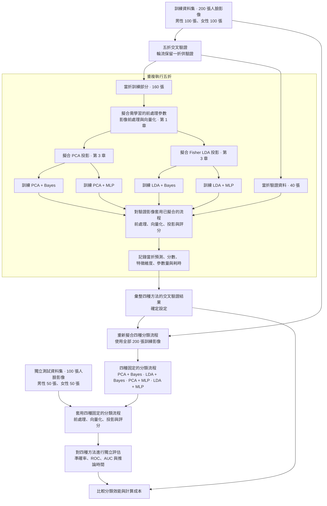

# 講義對照與系統架構

[English](../en/lecture-reference.md) · [專題說明](project-requirements.md) · [專案首頁](../../README.md)

## A. 專題要求與課堂講義對照

資料來源為合併講義 `all.pdf`，共 480 頁。**PDF 頁碼**是該檔案中從 1 起算的頁序。**原始投影片頁碼**是投影片上印出的頁碼，可能隨章節重新起算。第 6 章從 PDF 第 379 頁的未編號封面開始，印有第 1 頁的投影片是 PDF 第 380 頁。

涵蓋程度依投影片實際講授的內容判定。「完整涵蓋」表示講義有說明專題所需的方法或概念。實作備註說明如何將講義內容應用於本專題。評分、成果與截止日期請見[正式專題說明](project-requirements.md)。

| 專題要求 | 講義章節 | PDF 頁碼 | 原始投影片頁碼 | 涵蓋程度 | 實作備註 |
|---|---|---|---|---|---|
| 訓練、驗證與獨立測試 | 第 1 章 §§1.4.4–1.4.5、第 6 章 §6.3.3 | 37–38、418–420 | 第 1 章 37–38、第 6 章 39–41 | 部分涵蓋 | 講義討論訓練、泛化能力，以及驗證集與測試集的不同用途。實作可設定的資料路徑、逐折擬合，以及保留影像的最終測試。 |
| 影像前處理與特徵向量 | 第 1 章 §1.2（分類器設計範例）、§1.3 | 12、25–29 | 12、25–29 | 部分涵蓋 | 講義介紹特徵空間、感測、分割、特徵萃取與分類。實作時訂定一致的影像表示與向量排列順序，並以訓練樣本估計需從資料學習的前處理參數。 |
| 主成分分析（PCA） | 第 3 章 §3.8.1 | 277–290 | 89–102 | 完整涵蓋 | 講義推導先減去平均值，再投影至散布矩陣的主要特徵向量以最小化重建誤差的方法。使用訓練資料決定保留維度，並在評估時沿用已擬合的平均值與投影。 |
| 線性判別分析（LDA） | 第 3 章 §3.8.2 | 291–312 | 103–124 | 完整涵蓋 | 講義以類間與類內散布推導二類 Fisher 投影，並提供計算範例。使用有標籤的訓練資料擬合投影，必要時處理類內散布矩陣奇異的情況。 |
| 多類別判別分析（MDA） | 第 3 章 §3.8.3 | 313–316 | 125–128 | 完整涵蓋 | 講義以類間散布矩陣、類內散布矩陣與行列式準則說明多類別投影。此一般化方法有助理解 Fisher LDA 在本專題二類情境下只有一個判別方向。 |
| 貝氏分類器（Bayes Classifier） | 第 2 章 §§2.2–2.6 | 74–84、86–115、117–126、128–141、143–179 | 25–35、37–66、68–77、79–92、94–130 | 完整涵蓋 | 講義涵蓋先驗機率、後驗機率、決策風險、判別函數與高斯共變異數的各種情況。選擇概似模型，以訓練特徵擬合參數，並輸出類別與連續分數。 |
| 高斯分布 | 第 2 章 §2.5 | 128–141 | 79–92 | 完整涵蓋 | 講義說明單變量與多變量高斯密度、共變異數、白化及等密度輪廓的幾何意義。在投影後的特徵空間選擇共變異數結構，並以數值穩定的方式計算對數密度。 |
| 最大概似參數估計 | 第 3 章 §§3.2.1–3.2.4 | 195–221 | 7–33 | 完整涵蓋 | 講義推導最大概似與對數概似，說明高斯平均值及共變異數的估計，並討論估計量的偏差。使用各折的訓練特徵，並記錄共變異數的正規化慣例。PDF 第 220–221 頁接續完成偏差推導。 |
| 多層感知器（MLP） | 第 6 章 §§6.2–6.3 | 386–394、396–420 | 7–15、17–41 | 完整涵蓋 | 講義涵蓋網路層、權重、偏差項、活化函數、監督式學習與訓練方式。選擇並記錄網路架構與訓練設定，保留連續輸出以分析 ROC。 |
| 前饋運算 | 第 6 章 §§6.2–6.2.1 | 386–394 | 7–15 | 完整涵蓋 | 講義示範加權輸入、偏差項、活化函數，以及如何以輸出作為類別的判別分數。將已擬合的網路應用於 PCA 或 LDA 特徵，並定義正類分數。 |
| 反向傳播 | 第 6 章 §§6.3–6.3.3 | 396–420 | 17–41 | 完整涵蓋 | 講義推導梯度更新，並提供隨機與批次演算法。使用當折訓練部分設定初始化與停止準則，保留當折的驗證資料供評估，獨立測試資料僅供最終測試。 |
| PCA／LDA 與 Bayes／MLP 四種分類流程 | 第 1 章 §§1.3–1.4，以及上列各方法章節 | 25–38 | 25–38 | 部分涵蓋 | 講義說明辨識流程與設計循環。將對應方法組成四種分類流程，並共用相同的分折與評估流程。 |
| ROC 曲線 | 第 2 章 §2.8.3 | 181–186 | 132–137 | 完整涵蓋 | 講義定義命中率與誤警率，並說明如何以不同閾值描繪 ROC 曲線。實作時以連續分數與已知標籤計算觀察到的真正率（TPR）與偽正率（FPR）。 |
| ROC 曲線下面積（AUC） | 第 2 章 §2.8.3（相關 ROC 內容） | 181–186 | 132–137 | 僅涵蓋相關理論 | 講義明確說明 ROC 座標軸與閾值掃描，但未定義 AUC 或提供計算步驟。須以實際資料的 ROC 曲線計算面積，並記錄評分與同分處理慣例。 |
| 分類準確率 | 第 2 章 §2.3（最小錯誤率與零一損失） | 86–90 | 37–41 | 部分涵蓋 | 講義說明零一損失下的正確與錯誤決策，以及如何最小化期望錯誤率。專題須以正確預測數除以評估樣本數，並說明各折結果如何彙整。 |
| 五折交叉驗證 | 第 1 章 §1.4.5、第 6 章 §6.3.3（相關評估內容） | 38、418–420 | 第 1 章 38、第 6 章 39–41 | 僅涵蓋相關理論 | 講義討論過度擬合，以及驗證集與測試集的角色，但未提供分成五折、輪流保留驗證折及彙整結果的步驟。這些步驟僅使用訓練資料集實作。 |
| 特徵向量維度分析 | 第 3 章 §§3.7–3.8 | 258–274、276–316 | 70–86、88–128 | 部分涵蓋 | 講義說明維度、樣本數、準確率及計算複雜度之間的關係，並推導線性投影。記錄輸入及保留的維度，並以實驗比較其影響。 |
| 模型參數量 | 第 3 章 §§3.2.3、3.7.2、第 6 章 §§6.2–6.3.1 | 第 3 章 211–216、268–272；第 6 章 386–394、396–398 | 第 3 章 23–28、80–84；第 6 章 7–15、17–19 | 部分涵蓋 | 講義列出共變異數矩陣的相異元素數量，並說明高斯平均值、先驗機率、MLP 權重與偏差項。統一參數計數範圍，以及共用、固定與冗餘參數的計數方式。 |
| 訓練時間分析 | 第 3 章 §3.7.2 | 266–272 | 78–84 | 僅涵蓋相關理論 | 講義分析高斯參數估計的運算次數，包含特徵維度與樣本數的影響。以一致的計時範圍量測前處理擬合、投影擬合與分類器訓練的實際耗時。 |
| 推論時間分析 | 第 3 章 §3.7.2 | 266–267、273 | 78–79、85 | 僅涵蓋相關理論 | 講義分析高斯判別函數對單一測試向量分類的運算次數。以一致的批次大小量測評估流程，並說明計時包含哪些操作。 |
| MATLAB 實作 | 合併講義未提供 MATLAB 專屬教學 | — | — | 未涵蓋 | 正式專題說明要求使用 MATLAB。選擇 MATLAB 函式或自行撰寫程式完成資料載入、擬合、評分、繪圖與計時，並記錄設定與流程。 |

## B. 期末專題系統架構

- **擬合與套用。** 每折僅使用當折 160 張訓練影像來估計需學習的前處理參數、PCA 平均值與投影、監督式 LDA 投影，以及各分類器的參數。套用固定的流程評估當折保留的 40 張影像。上述張數以等大分折為前提。每張影像在五折中恰好被保留驗證一次。
- **對應講義。** 第 1 章涵蓋特徵向量與圖形識別系統。第 2 章涵蓋貝氏分類器與 ROC。第 3 章涵蓋 PCA、Fisher LDA 與參數估計。第 6 章涵蓋 MLP 前饋推論與反向傳播。
- **交叉驗證的輸出。** 每種分類流程均須報告準確率、ROC、AUC、特徵向量維度、模型參數量、訓練時間與推論時間。比較時共用相同的分折。若調整超參數，僅使用訓練資料，並記錄選擇流程。若要評估調參程序，可在每折的訓練部分內另作切分，以保留該折的驗證資料供評估。
- **獨立測試的輸出。** 使用 100 張測試影像之前，先固定四種最終分類流程。測試資料僅用於最終評估，每種方法均報告準確率、ROC、AUC 與推論時間。特徵維度、模型參數量與訓練時間取自訓練階段的分析。

## C. 實作考量

須使用 MATLAB 等正式規範請見[專題說明](project-requirements.md)。下列做法皆為實作選擇。

- **高維影像向量。** 展平影像後，特徵數可能遠超過訓練樣本數。保持像素排列順序一致。灰階轉換、影像縮放與強度正規化皆可視情況選用，並記錄及一致地套用。
- **奇異共變異數矩陣。** 由 $n$ 筆樣本中心化後得到的樣本共變異數矩陣，秩最多為 $n-1$。在高維或具有冗餘特徵時，高斯共變異數矩陣或類內散布矩陣可能為奇異矩陣。可考慮選擇合適的共變異數結構或使用正則化，並在適用時採用穩定的矩陣分解或線性方程組求解法。
- **以精簡奇異值分解（economy SVD）實作 PCA。** 將各樣本排列在矩陣各列，先對訓練矩陣做中心化，再取主要右奇異向量作為投影方向。精簡 SVD 可避免建立完整的特徵對特徵散布矩陣。保留的成分數以數值秩為上限，並對保留資料沿用訓練平均值。
- **正則化 Fisher LDA。** 二類問題的一種做法是求解 $(S_W + \lambda I)w = \mu_1-\mu_2$，其中 $S_W$ 為類內散布矩陣，且 $\lambda > 0$。使用當折訓練部分估計類別平均值與散布，並以訓練資料選擇正則化強度。純量投影為 $w^\top x$。
- **防止資料洩漏並依受試者分組。** 先切分資料，再擬合任何轉換。如果有可靠的受試者識別碼，且同一人有多張影像，可考慮將該受試者的影像全數分配到同一折。盡可能維持類別平衡，並記錄實際的分折張數與圖中示例的差異。
- **ROC 與 AUC 使用連續分數。** 全程使用相同的正類。貝氏分類器可使用後驗機率或對數判別分數差，MLP 可使用正類輸出分數。以不同閾值掃描保留資料的分數以取得 ROC 各點，再計算面積，例如將同分樣本一併處理後採梯形積分。
- **一致的參數計數。** 若高斯貝氏模型有 $d$ 個特徵與 $C$ 個類別，每一類的完整共變異數矩陣各有 $d(d+1)/2$ 個相異元素，每一類的平均值向量各有 $d$ 個元素。共用的共變異數矩陣僅計一次，先驗機率若由資料估計則納入 $C-1$ 個獨立參數。各層寬度為 $n_0,\ldots,n_L$ 的全連接 MLP 共有 $\sum_{\ell=1}^{L}(n_{\ell-1}+1)n_\ell$ 個權重與偏差項。統一分類器的計數方式，若也統計需學習的前處理及投影參數，另列其數量。
- **一致的計時方式。** 定義訓練與推論的計時範圍，例如前處理、投影、評分及磁碟讀寫。使用一致的硬體與批次大小，多次量測並報告單位及彙整方式。註明推論時間是以單張影像還是整批計算。
